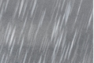

**Day 3**

> Give me your tired, your poor, your huddled masses yearning to breathe free, The wretched refuse of your teeming shore. Send these, the homeless, tempest-tost to me, I lift my lamp beside the golden door.
>
> -Inscibed on the Statue of Liberty

Manhatten and her 5 buroughs can assault your senses. The night rain deepens the darkness and really gives you a sense of Delillo's
[American magic and dread](http://www.amazon.com/exec/obidos/redirect?link_code=ur2&camp=1789&tag=theroadislife-20&creative=9325&path=http://www.amazon.com/gp/product/0812235517?v=glance&n=283155&v=glance)

. The city is crammed into an impossibly small island, that acts as a giant magnet; drawing everything irreversibly to her. This, of course isn't a new phenomen. She's been at it for some time now; seducing the worlds huddled masses for more than 200 years.
  
  

Lady Liberty.

New York, New York.

Last night was a blur of small Brooklyn bars capped with a 3 a.m. breakfast of bacon and eggs. Leonard Cohen woke us up. It somehow seems appropriate on this sad, rainy New York day. We need to get out of this apartment and get downtown....
